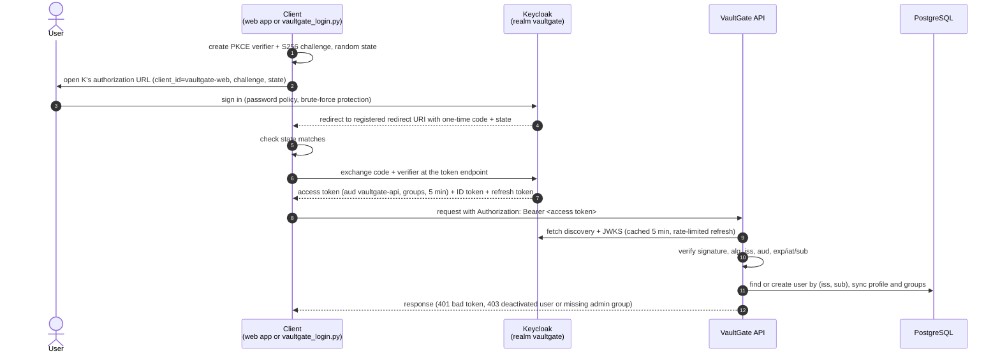

# Authentication

How a person gets from "not logged in" to an API call VaultGate trusts, and what each
component checks on the way. Design reasoning is in
[ADR 0002](adr/0002-api-as-oidc-resource-server.md).

## Flow



## What each step guarantees

| Step | Enforced by | Guarantee |
|---|---|---|
| Authorization request | Keycloak client `vaultgate-web` | Only the code flow with **PKCE S256**; no password grant, no implicit flow; redirects only to registered URIs |
| Login | Keycloak realm | Password policy (12+ characters), brute-force lockout, no self-registration |
| Code exchange | PKCE | A stolen code is useless without the verifier, which never leaves the client |
| Callback | Client (`state`) | A redirect that answers someone else's request is rejected |
| Every API request | `vaultgate_api.auth` | Asymmetric signature from the realm's JWKS, header `alg` bound to the key, exact `iss`, `aud` contains `vaultgate-api`, not expired; ID tokens are refused (wrong audience) |
| Every API request | `vaultgate_api.provisioning` | The caller has a local user record matching the token; deactivated users get `403` |
| Admin endpoints | `require_admin` | Membership in `VAULTGATE_ADMIN_GROUPS` according to the current token |
| All routes | `protected` router + test | Deny by default: a route without authentication fails CI unless listed as public |

## Getting a token from a terminal

`scripts/vaultgate_login.py` is a client like the future web app: it runs the flow
above against Keycloak with your browser and prints the access token.

```bash
make up                         # Keycloak, API, Postgres...
TOKEN=$(make -s token)          # opens the browser; log in as alice, bob or carol
curl -H "Authorization: Bearer $TOKEN" http://localhost:8000/me
```

- It listens on `127.0.0.1:8765` only, for one callback, and gives up after 3 minutes.
- The token goes to stdout and nothing is written to disk; progress goes to stderr.
- `--no-browser` prints the login URL instead of opening it (remote shells);
  `--json` prints the whole token response; `--issuer` points at another realm.
- Access tokens live 5 minutes. Run it again for a new one.

The seed users and their passwords are in the README (local development only).

## Testing

`make auth-check` (CI job `auth-e2e`) exercises the whole path with real containers:
each seed user logs in through the PKCE flow, the API accepts their access tokens and
provisions them, refuses ID tokens and non-admins on `/admin`, and the login helper
refuses a callback with the wrong `state` without aborting, then completes a browser login.
