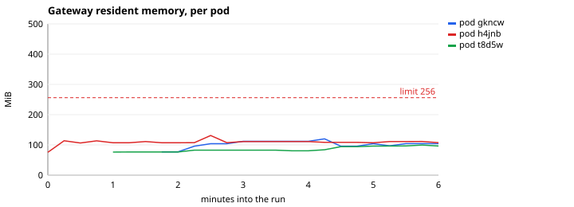
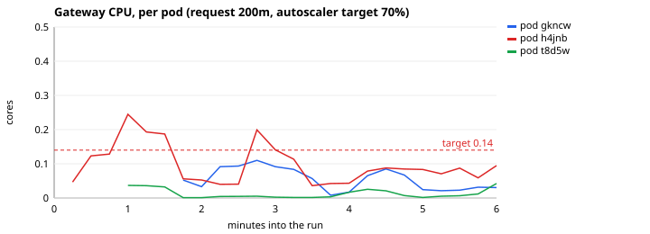
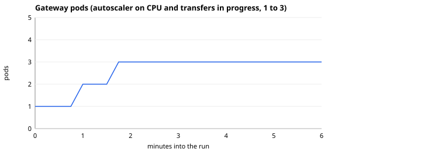
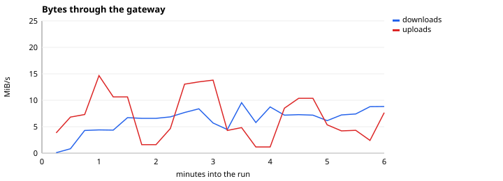
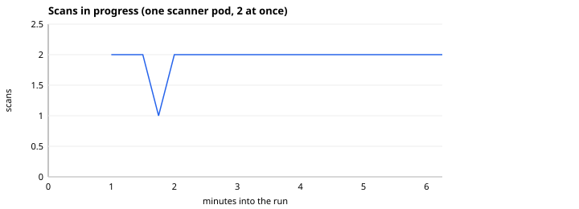

# Load test report

<!-- Generated by loadtest/report.py from a `make load-report` run; do not edit. -->

Measured on a GitHub-hosted runner (Linux x86_64, 4 CPUs, 15 GiB of memory), against the local k3d cluster (ADR 0009, 0010), at commit `913dfa7`, on 2026-11-06 00:22 UTC. Profile: 20 users (Transfers, ControlPlane and Documents weighted 3:2:1) for 6 minutes, uploads up to 128 MiB. Everything (the cluster, PostgreSQL, LocalStack, Keycloak, Prometheus and Locust itself) shares that one machine, so the numbers describe VaultGate's behaviour, where it saturates and what stays flat, not what production hardware would do. How the scenarios and the thresholds work: [ADR 0011](adr/0011-load-testing.md).

## Summary

- **17485 requests in 6.2 minutes, 0 failed.** Thresholds (`loadtest/check.py`): passed.
- **5.9 GiB through the gateway** (uploads and downloads), up to 16 MiB/s of uploads.
- **Gateway memory peaked at 137 MiB per pod** (limit 256 MiB, threshold 230 MiB): under the threshold, with uploads of up to 128 MiB in flight.
- **The gateway ran on up to 2 pods** (autoscaler: 1 to 3), with a peak of 0.16 cores in one pod: the autoscaler added pods during the run.
- **Up to 2 scans ran at once** in the one scanner pod (its limit is 2), at that limit for 95% of the run: the scanner was the bottleneck, and most of the time to a verdict was spent in its queue.

## Requests

HTTP requests, as Locust measured them (client side, so including the network inside the cluster):

| Request | Count | Failed | Median | p95 | p99 | Max | Per second |
|---|---:|---:|---:|---:|---:|---:|---:|
| GET /downloads/{id} 128 MiB | 14 | 0 | 45 ms | 150 ms | 150 ms | 155 ms | 0.04 |
| GET /downloads/{id} 256 KiB | 55 | 0 | 51 ms | 260 ms | 470 ms | 475 ms | 0.15 |
| GET /downloads/{id} 32 MiB | 25 | 0 | 41 ms | 140 ms | 260 ms | 264 ms | 0.07 |
| GET /downloads/{id} 4 MiB | 64 | 0 | 50 ms | 120 ms | 150 ms | 151 ms | 0.18 |
| GET /files | 877 | 0 | 21 ms | 140 ms | 230 ms | 292 ms | 2.44 |
| GET /files/{id} | 531 | 0 | 19 ms | 120 ms | 220 ms | 313 ms | 1.48 |
| GET /files/{id} (poll scan) | 14131 | 0 | 21 ms | 100 ms | 200 ms | 397 ms | 39.34 |
| GET /me | 580 | 0 | 12 ms | 78 ms | 160 ms | 185 ms | 1.61 |
| POST /files | 224 | 0 | 46 ms | 150 ms | 390 ms | 436 ms | 0.62 |
| POST /files/{id}/download | 158 | 0 | 29 ms | 120 ms | 190 ms | 263 ms | 0.44 |
| POST /files/{id}/download (intent only) | 349 | 0 | 29 ms | 130 ms | 270 ms | 316 ms | 0.97 |
| PUT /uploads/{id} 128 MiB | 16 | 0 | 3.00 s | 4.40 s | 4.40 s | 4.39 s | 0.04 |
| PUT /uploads/{id} 256 KiB | 57 | 0 | 110 ms | 280 ms | 460 ms | 459 ms | 0.16 |
| PUT /uploads/{id} 32 MiB | 27 | 0 | 690 ms | 1.80 s | 1.80 s | 1.76 s | 0.08 |
| PUT /uploads/{id} 4 MiB | 67 | 0 | 180 ms | 430 ms | 540 ms | 543 ms | 0.19 |
| PUT /uploads/{id} control plane | 7 | 0 | 76 ms | 530 ms | 530 ms | 531 ms | 0.02 |
| PUT /uploads/{id} document docx | 11 | 0 | 95 ms | 260 ms | 260 ms | 260 ms | 0.03 |
| PUT /uploads/{id} document pdf | 12 | 0 | 130 ms | 440 ms | 440 ms | 440 ms | 0.03 |
| PUT /uploads/{id} document pptx | 8 | 0 | 150 ms | 270 ms | 270 ms | 269 ms | 0.02 |
| PUT /uploads/{id} document text 8 MiB | 14 | 0 | 260 ms | 970 ms | 970 ms | 975 ms | 0.04 |
| PUT /uploads/{id} document xlsx | 5 | 0 | 82 ms | 170 ms | 170 ms | 172 ms | 0.01 |
| POST token | 40 | 0 | 61 ms | 140 ms | 160 ms | 156 ms | 0.11 |

## Time to a scan verdict

From the end of the upload to the scan's verdict, as the API reports it: the queue, the scanner reading and decrypting the object, extraction and detection, and the report back (polled every 250 ms).

| Request | Count | Failed | Median | p95 | p99 | Max | Per second |
|---|---:|---:|---:|---:|---:|---:|---:|
| SCAN upload → verdict 128 MiB | 14 | 0 | 48.00 s | 69.00 s | 69.00 s | 69.27 s | 0.04 |
| SCAN upload → verdict 256 KiB | 55 | 0 | 9.30 s | 57.00 s | 63.00 s | 63.07 s | 0.15 |
| SCAN upload → verdict 32 MiB | 25 | 0 | 16.00 s | 35.00 s | 41.00 s | 41.04 s | 0.07 |
| SCAN upload → verdict 4 MiB | 64 | 0 | 6.40 s | 38.00 s | 57.00 s | 56.83 s | 0.18 |
| SCAN upload → verdict control plane | 7 | 0 | 5.60 s | 16.00 s | 16.00 s | 16.02 s | 0.02 |
| SCAN upload → verdict document docx | 10 | 0 | 4.70 s | 61.00 s | 61.00 s | 61.21 s | 0.03 |
| SCAN upload → verdict document pdf | 12 | 0 | 9.40 s | 34.00 s | 34.00 s | 33.92 s | 0.03 |
| SCAN upload → verdict document pptx | 8 | 0 | 10.00 s | 28.00 s | 28.00 s | 27.84 s | 0.02 |
| SCAN upload → verdict document text 8 MiB | 13 | 0 | 24.00 s | 58.00 s | 58.00 s | 57.51 s | 0.04 |
| SCAN upload → verdict document xlsx | 5 | 0 | 25.00 s | 56.00 s | 56.00 s | 55.94 s | 0.01 |

## The gateway under load









## The scanner



## Reproducing it

```bash
pip install -r loadtest/requirements.txt
make k3d-up
make load-report    # the full run, then this report in docs/
```
