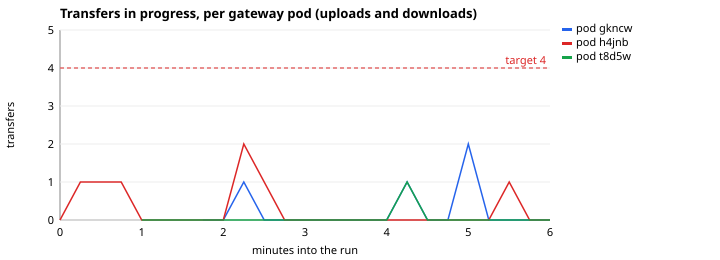

# Load test report

<!-- Generated by loadtest/report.py from a `make load-report` run; do not edit. -->

Measured on a GitHub-hosted runner (Linux x86_64, 4 CPUs, 15 GiB of memory), against the local k3d cluster (ADR 0009, 0010), at commit `e8409b7`, on 2026-11-10 15:42 UTC. Profile: 20 users (Transfers, ControlPlane and Documents weighted 3:2:1) for 6 minutes, uploads up to 128 MiB. Everything (the cluster, PostgreSQL, LocalStack, Keycloak, Prometheus and Locust itself) shares that one machine, so the numbers describe VaultGate's behaviour, where it saturates and what stays flat, not what production hardware would do. How the scenarios and the thresholds work: [ADR 0011](adr/0011-load-testing.md).

## Summary

- **15318 requests in 6.2 minutes, 0 failed.** Thresholds (`loadtest/check.py`): passed.
- **5.1 GiB through the gateway** (uploads and downloads), up to 15 MiB/s of uploads.
- **Gateway memory peaked at 131 MiB per pod** (limit 256 MiB, threshold 230 MiB): under the threshold, with uploads of up to 128 MiB in flight.
- **The gateway ran on up to 3 pods** (autoscaler: 1 to 3), with a peak of 0.24 cores in one pod: the autoscaler added pods during the run.
- **Up to 3 transfers were in progress at once**, 2 in one pod. The autoscaler adds pods above 4 per pod on average, or above 0.14 cores per pod (70% of the request), whichever asks for more: CPU passed its target and the transfers stayed under theirs.
- **Up to 2 scans ran at once** in the one scanner pod (its limit is 2), at that limit for 96% of the run: the scanner was the bottleneck, and most of the time to a verdict was spent in its queue.

## Requests

HTTP requests, as Locust measured them (client side, so including the network inside the cluster):

| Request | Count | Failed | Median | p95 | p99 | Max | Per second |
|---|---:|---:|---:|---:|---:|---:|---:|
| GET /downloads/{id} 128 MiB | 14 | 0 | 98 ms | 470 ms | 470 ms | 468 ms | 0.04 |
| GET /downloads/{id} 256 KiB | 63 | 0 | 110 ms | 450 ms | 820 ms | 816 ms | 0.18 |
| GET /downloads/{id} 32 MiB | 16 | 0 | 95 ms | 390 ms | 390 ms | 394 ms | 0.04 |
| GET /downloads/{id} 4 MiB | 42 | 0 | 100 ms | 290 ms | 590 ms | 592 ms | 0.12 |
| GET /files | 818 | 0 | 40 ms | 390 ms | 590 ms | 918 ms | 2.28 |
| GET /files/{id} | 527 | 0 | 34 ms | 400 ms | 540 ms | 790 ms | 1.47 |
| GET /files/{id} (poll scan) | 12246 | 0 | 30 ms | 340 ms | 540 ms | 1.03 s | 34.08 |
| GET /me | 520 | 0 | 21 ms | 250 ms | 350 ms | 602 ms | 1.45 |
| POST /files | 195 | 0 | 75 ms | 430 ms | 780 ms | 869 ms | 0.54 |
| POST /files/{id}/download | 135 | 0 | 47 ms | 330 ms | 530 ms | 601 ms | 0.38 |
| POST /files/{id}/download (intent only) | 325 | 0 | 52 ms | 420 ms | 720 ms | 895 ms | 0.90 |
| PUT /uploads/{id} 128 MiB | 15 | 0 | 3.90 s | 7.90 s | 7.90 s | 7.88 s | 0.04 |
| PUT /uploads/{id} 256 KiB | 67 | 0 | 220 ms | 830 ms | 1.40 s | 1.44 s | 0.19 |
| PUT /uploads/{id} 32 MiB | 18 | 0 | 1.10 s | 2.70 s | 2.70 s | 2.72 s | 0.05 |
| PUT /uploads/{id} 4 MiB | 45 | 0 | 340 ms | 790 ms | 1.20 s | 1.17 s | 0.13 |
| PUT /uploads/{id} control plane | 7 | 0 | 130 ms | 310 ms | 310 ms | 310 ms | 0.02 |
| PUT /uploads/{id} document docx | 11 | 0 | 200 ms | 630 ms | 630 ms | 633 ms | 0.03 |
| PUT /uploads/{id} document pdf | 5 | 0 | 220 ms | 730 ms | 730 ms | 734 ms | 0.01 |
| PUT /uploads/{id} document pptx | 10 | 0 | 220 ms | 420 ms | 420 ms | 419 ms | 0.03 |
| PUT /uploads/{id} document text 8 MiB | 12 | 0 | 520 ms | 1.70 s | 1.70 s | 1.72 s | 0.03 |
| PUT /uploads/{id} document xlsx | 5 | 0 | 230 ms | 1.00 s | 1.00 s | 1.03 s | 0.01 |
| POST token | 40 | 0 | 73 ms | 170 ms | 180 ms | 178 ms | 0.11 |

## Time to a scan verdict

From the end of the upload to the scan's verdict, as the API reports it: the queue, the scanner reading and decrypting the object, extraction and detection, and the report back (polled every 250 ms).

| Request | Count | Failed | Median | p95 | p99 | Max | Per second |
|---|---:|---:|---:|---:|---:|---:|---:|
| SCAN upload → verdict 128 MiB | 14 | 0 | 53.00 s | 80.00 s | 80.00 s | 79.94 s | 0.04 |
| SCAN upload → verdict 256 KiB | 63 | 0 | 8.20 s | 44.00 s | 65.00 s | 64.67 s | 0.18 |
| SCAN upload → verdict 32 MiB | 16 | 0 | 25.00 s | 73.00 s | 73.00 s | 73.16 s | 0.04 |
| SCAN upload → verdict 4 MiB | 42 | 0 | 16.00 s | 37.00 s | 42.00 s | 41.76 s | 0.12 |
| SCAN upload → verdict control plane | 7 | 0 | 8.10 s | 20.00 s | 20.00 s | 20.16 s | 0.02 |
| SCAN upload → verdict document docx | 10 | 0 | 21.00 s | 42.00 s | 42.00 s | 41.98 s | 0.03 |
| SCAN upload → verdict document pdf | 4 | 0 | 13.00 s | 32.00 s | 32.00 s | 32.34 s | 0.01 |
| SCAN upload → verdict document pptx | 9 | 0 | 9.40 s | 61.00 s | 61.00 s | 60.71 s | 0.03 |
| SCAN upload → verdict document text 8 MiB | 12 | 0 | 26.00 s | 64.00 s | 64.00 s | 64.49 s | 0.03 |
| SCAN upload → verdict document xlsx | 5 | 0 | 21.00 s | 36.00 s | 36.00 s | 35.82 s | 0.01 |

## The gateway under load





## The scanner


## Reproducing it

```bash
pip install -r loadtest/requirements.txt
make k3d-up
make load-report    # the full run, then this report in docs/
```
