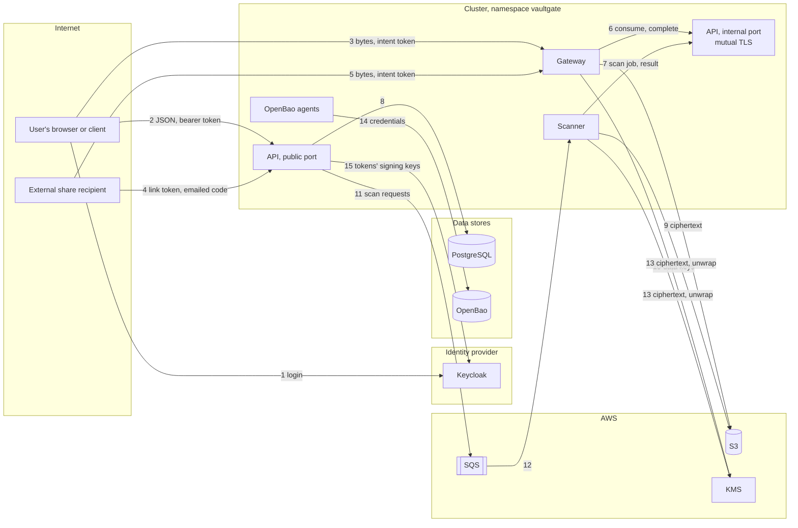

# Threat model

M10's threat model: STRIDE over VaultGate's data flows, as of November 2026 (after M9's
PKI and M10's service identity). Every threat lists what stands against it and where
that is decided or tested. A threat that nothing fully covers is a finding, numbered
**TM-n**, either open (its fix is M10's last step) or accepted with its reason. The
audit report ([audit-report.md](audit-report.md)) gathers these findings with those of
the scans.

## What is protected

| Asset | Where it lives | Why it matters |
| --- | --- | --- |
| File contents | S3, encrypted (VGE1, ADR 0003); in memory in the gateway and the scanner | The reason VaultGate exists |
| Data keys | Wrapped by KMS, in PostgreSQL; unwrapped in memory per transfer or scan | Each one opens one file |
| The KMS key | KMS | Unwraps every data key |
| Personal data findings | PostgreSQL: the kind and the count, never the values (ADR 0005) | Says which files hold PII |
| Identities and groups | The identity provider; PostgreSQL mirrors users | Who may do what |
| Access policies | PostgreSQL (ADR 0004) | Deny by default; what they allow is the attack surface |
| Intent tokens | PostgreSQL, hashed; with the client for minutes | Each spends one transfer |
| Share links and codes | PostgreSQL, hashed; the link with the recipient | Access for people outside the organization |
| The audit log | PostgreSQL, append-only and hash-chained (ADR 0007) | Accountability |
| Service credentials | OpenBao (ADR 0012), files in memory-backed volumes | The internal tokens, AWS keys, database logins |
| The PKI | The offline root (the operator), the intermediate (OpenBao) | Every TLS hop and service identity |

## Data flows and trust boundaries

Every flow is TLS 1.3 on the cluster (ADR 0012), and none is plain HTTP; the negative
tests check the outside ones (docs/security-scans.md). The trust boundaries:

- **The internet and the cluster (flows 2 to 5).** Anyone can send anything here. The
  API authenticates every request, and the gateway accepts only intents the API
  issued.
- **The public and the internal API (6, 7).** Only the gateway and the scanner may
  reach the internal port. The network policy, the client certificate with its
  identity (ADR 0013) and the token must all agree.
- **VaultGate and its stores (8 to 13).** PostgreSQL logins are short-lived, one per
  API pod (ADR 0012). AWS stores only ciphertext and wrapped keys.
- **The cluster and its operator.** The operator holds the root CA's key and, on the
  local cluster, everything else. Cluster administrators are trusted: they can read
  Secrets and exec into pods.

## STRIDE

Each row is a threat to an element or flow. The **status** is one of:
- **mitigated**: something in place stands against the threat, cited in the row;
- **accepted**: a known limit, with its reason under [Accepted](#accepted);
- **open**: a finding whose fix is M10's last step.

### Spoofing

| Threat | Against it | Status |
| --- | --- | --- |
| A forged or altered access token at the API | Signature against the issuer's JWKS, RS256 only, `iss`, `aud`, `exp` checked on every request (ADR 0002); the negative tests send no token, a non-JWT, a changed payload and `alg: none` to all 25 protected routes | mitigated |
| A stolen access token | Lives 5 minutes; TLS everywhere; no cookies, so no CSRF; the token is never logged | mitigated |
| Someone else's intent token at the gateway | 256-bit random, hashed at rest, single use, minutes long, bound to one file and one direction (upload or download); tested by the end-to-end check and the negative tests | mitigated |
| A guessed share link or code | The link is 256-bit random; the code is 6 digits, valid 10 minutes, 5 attempts each, at most 5 sent an hour, mailed to the recipient's address (ADR 0006) | mitigated |
| A recipient's mailbox taken over | The share is as safe as that mailbox; shares expire, count downloads and can be revoked at once | accepted (TM-8) |
| Something else posing as the gateway or the scanner on the internal port | Network policy, a client certificate from VaultGate's root naming the caller, and the caller's token (ADR 0013); `scripts/mtls_check.py` | mitigated |
| A certificate naming a service, issued to someone else | Only a `Certificate` in VaultGate's namespace can get one (a namespaced Issuer, an OpenBao role bound to it); anyone who can create one there can already read the services' Secrets | accepted (TM-9) |
| A fake server (the API, PostgreSQL, OpenBao, Keycloak) | Every client verifies the server's certificate against the cluster's trust bundle | mitigated |
| A spoofed client address to get around an IP policy | `X-Forwarded-For` is believed only from `trusted_proxies`; the gateway passes the address it saw, and the API re-checks the policies with it | mitigated |

### Tampering

| Threat | Against it | Status |
| --- | --- | --- |
| Altered, reordered or truncated ciphertext in S3 | AES-256-GCM per chunk with the chunk's position and the last chunk's flag in its nonce (ADR 0003); downloads abort on any failure | mitigated |
| A data key moved to another file | KMS's encryption context binds each wrapped key to its file's ID | mitigated |
| An upload of other bytes than declared | The gateway requires exactly the declared size, hashes as it goes, and reports the SHA-256 the download then carries | mitigated |
| A file crafted to make the scanner see something else (encodings, nesting, RTF `\u` overflow) | Text is decoded as a viewer shows it; limits on nesting and expansion; an out-of-range `\u` becomes U+FFFD (fixed in M10); unreadable files are unscannable, never clean | mitigated |
| An audit event changed or deleted | A trigger refuses it for every role; a hash chain whose head is anchored in the logs (ADR 0007) | mitigated |
| The audit log and the logs rewritten together by someone with superuser rights | Not prevented: external write-once anchoring is future work (ADR 0007) | accepted (TM-10) |
| Manifests changed in the cluster | Argo CD syncs from git and reverts drift | mitigated |
| A tampered image | Built from the repository, scanned by Trivy, pulled from the cluster's own registry; not signed, and not pinned by digest | accepted (TM-11) |

### Repudiation

| Threat | Against it | Status |
| --- | --- | --- |
| A user denies an upload, download, share or policy change | Each is an audit event with the user, the client address and the request's ID, in the hash-chained log | mitigated |
| An administrator denies a release, a rescan or a policy change | The same, with their reason | mitigated |
| A refused attempt leaves no trace | Refusals are audited (unknown intent tokens excepted: they name nothing, and anyone can send one), and counted in metrics | mitigated |

### Information disclosure

| Threat | Against it | Status |
| --- | --- | --- |
| Plaintext in storage | Only VGE1 ciphertext reaches S3; the end-to-end check reads the object and looks for the plaintext | mitigated |
| Personal data in the database or the logs | Only the kind and count of findings; logs carry paths, never query strings or tokens | mitigated |
| Another user's file or its metadata | The owner check answers 404, as for a file that doesn't exist; the negative tests check it for bob | mitigated |
| A browser rendering or caching a response, or another site embedding it | `nosniff`, `default-src 'none'`, CORP `same-origin`, `no-store`, HSTS on every response (M10); downloads are attachments with a sandbox CSP | mitigated |
| Version banners and error details | No `Server` header; errors are short JSON (M10); ZAP's disclosure rules pass | mitigated |
| The API's interactive documentation is public | `/docs`, `/redoc` and `/openapi.json` describe every route to anyone; they show nothing a client can't reach, but they map it | open (TM-6) |
| A process listening on the network reads traffic | TLS 1.3 on every hop, no plain HTTP (M9, M10) | mitigated |
| Secrets in git, images or environment variables | gitleaks over the whole history; credentials come from OpenBao as files, never environment variables (`make k3d-check` checks the deployments) | mitigated |
| Metrics ports reachable from every pod | `/metrics` carries counts and route names, no secrets, but any pod in the cluster may read it | open (TM-5) |
| A compromised scanner (it parses untrusted files) sends what it decrypts elsewhere | PDFs are parsed in a WebAssembly sandbox with memory and time limits, and the image is distroless. But nothing limits where a VaultGate pod connects out | open (TM-1) |
| One service's AWS credentials used for another's work | API, gateway and scanner share one AWS credential, so the scanner, which only reads, can also write and delete objects | open (TM-2) |
| Known vulnerabilities in the images | Trivy gates on fixable HIGH and CRITICAL; the Python images still carry Debian packages with unfixed CVEs | open (TM-7) |

### Denial of service

| Threat | Against it | Status |
| --- | --- | --- |
| Many or huge uploads | A size limit per upload, at most 20 open uploads per user, the gateway's memory flat per transfer (M8 load tests) | mitigated |
| A decompression or parsing bomb at the scanner | Limits on expansion, nesting and time; PDFium capped in memory and time; the file is unscannable, not clean | mitigated |
| Request floods at the API or the gateway | No rate limits beyond the per-user ones; the gateway's autoscaler absorbs load, not abuse | open (TM-3) |
| Slow clients holding the gateway's connections | Tornado's defaults: a connection may idle for an hour | open (TM-4) |
| Share codes mailed in a loop | At most 5 an hour per share | mitigated |
| The identity provider hammered through the API with random key IDs | Refreshing the JWKS is itself rate limited | mitigated |
| A stopped scanner or queue | Scan requests wait in the queue and the API resends them; nothing is downloadable before its scan | mitigated |

### Elevation of privilege

| Threat | Against it | Status |
| --- | --- | --- |
| A user reaches administrator routes | Group membership from the token; the negative tests send alice to all 15 `/admin` routes | mitigated |
| A user gets around an access policy | Policies are evaluated on every request, deny wins, deny by default (ADR 0004); the gateway's intents are re-checked at the moment of transfer | mitigated |
| A quarantined file downloaded or shared | Only a clean file, or one an admin released, can be downloaded; a released file still can't be shared (ADR 0005, 0006) | mitigated |
| A service reads another's credentials | One OpenBao role per service, which reads only its own (checked by `make k3d-check`) | mitigated |
| A compromised pod escalates on its node | Non-root, no capabilities, no privilege escalation, seccomp, read-only root filesystems (M10); Trivy config and kube-linter gate the manifests | mitigated |
| SQL injection | SQLAlchemy throughout, no string-built SQL; Semgrep's SQLAlchemy rules pass | mitigated |
| An API login in PostgreSQL outlives its pod | Each is short-lived and dropped when its lease ends (ADR 0012) | mitigated |
| A forged certificate from the CA | The root's key is offline; the intermediate's key never leaves OpenBao; the intermediate is name-constrained | mitigated |
| Anyone with the local cluster's seal key or bootstrap passwords | Locally, OpenBao's seal key is a Secret and Keycloak's admin password is in its manifest; both are for the local cluster only (ADR 0009, 0012) | accepted (TM-12) |

## Findings

### Open: fixed in M10's last step

- **TM-1. No egress network policies.**
  - **Problem.** The network policies say who may connect to each component, but not
    where a component may connect. A scanner made to run code by a crafted file could
    send what it decrypts anywhere.
  - **Fix.** Egress policies: each service may reach its own dependencies only (the
    API, PostgreSQL, OpenBao, AWS's endpoints, DNS, Alloy).
- **TM-2. One AWS credential for three services.**
  - **Problem.** The API sends scan requests, the gateway writes and reads objects, and
    the scanner reads objects and unwraps keys, but all three hold the same
    credential, and so the union of their rights.
  - **Fix.** One IAM identity per service in Terraform, each with its own least-privilege
    policy, and one OpenBao secret per service.
- **TM-3. No rate limits on the public API and the gateway.**
  - **Problem.** Floods are bounded only by the per-user limits and autoscaling.
  - **Fix.** Decide where limits belong: the ingress (configured in the chart) or in
    each service. Then apply them per client address, and per user where the API knows
    who it is.
- **TM-4. The gateway's connection timeouts are Tornado's defaults.**
  - **Problem.** A connection may idle for an hour, so slow clients can tie up the
    gateway.
  - **Fix.** Set an idle timeout and a header timeout that real transfers never hit,
    then show with the load tests that they don't.
- **TM-5. Metrics ports reachable from every pod.**
  - **Problem.** The network policies let any pod in the cluster read every service's
    `/metrics`.
  - **Fix.** Limit those ports to the monitoring namespace (Prometheus).
- **TM-6. The API's interactive documentation is public.**
  - **Problem.** `/docs`, `/redoc` and `/openapi.json` map every route for anyone, and
    the docs pages load third-party scripts.
  - **Fix.** Make them a setting, off by default in the chart and on locally (ZAP reads
    `/openapi.json`).
- **TM-7. Unfixed vulnerabilities in the Python images' base.**
  - **Problem.** `python:3.12-slim` carries Debian packages the services never run, with
    HIGH CVEs and no fix released (docs/security-scans.md).
  - **Fix.** A slimmer base for the API and the gateway (distroless Python, or one with
    the interpreter only).

### Accepted

- **TM-8. A share is as safe as the recipient's mailbox** (ADR 0006). Shares expire,
  count downloads and can be revoked at once; a stronger proof of identity would need
  the recipient to have an account.
- **TM-9. Anyone who may create a `Certificate` in VaultGate's namespace can get a
  service's identity** (ADR 0013). They could already read the services' Secrets.
  Binding identities to pods would take cert-manager's CSI driver or SPIRE, which M11
  considers.
- **TM-10. A superuser can rewrite the audit log and the logs together** (ADR 0007).
  External write-once anchoring, signed with the M9 PKI's keys, is the next step for
  the audit log, outside M10.
- **TM-11. Images aren't signed or pinned by digest.** M12 moves them to GHCR with the
  chart pinned to them; signing and provenance belong there.
- **TM-12. The local cluster's own shortcuts.**
  - OpenBao's seal key is a Kubernetes Secret.
  - Keycloak runs in development mode with a bootstrap admin password in its manifest.
  - Secrets aren't encrypted at rest.

  The local cluster is a development and CI environment whose operator holds
  everything anyway. A production deployment uses a cloud KMS seal (ADR 0012), a
  production Keycloak or another provider, and the platform's encryption at rest.

## Out of scope

- **The identity provider's own security:** password policy, MFA, its admin console.
  VaultGate relies on the tokens it signs.
- **The clients' devices.** Device posture is out of scope (ADR 0004).
- **AWS's and Kubernetes' own security**, beyond how VaultGate configures and uses
  them.
- **Physical and organizational controls.**
